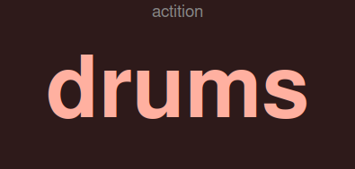

midi-event-remapper
===================

A MIDI event remapper built on top of `mididings`_ and JACK.  It can remap
essentially any incoming MIDI event (CC, PC, Note) to any outgoing event or
sequence of events, with support for chords, long press, double/triple
press, toggles, and switchable mapping banks -- all configured in a simple
data file with no programming required.

It is mainly intended for MIDI controllers such as footswitches, where it
adds gestures -- double press, long press, hold-repeat, and more -- on top
of hardware that only sends simple presses.  Long press and hold-repeat
need a *momentary* input: a press paired with its own release, so the
remapper can measure how long the control was held.  Double and triple
press need no release at all -- they only count presses within a time
window -- so they also work on event types that have no release signal,
such as Program Change.

.. _mididings: https://github.com/mididings/mididings

.. contents:: Contents
   :depth: 2
   :local:

Installation
------------

The package is not on PyPI.  Clone the repository first::

    git clone https://github.com/abarker/midi-remapper.git
    cd midi-remapper

Installing into a virtual environment is recommended.  Create one inside
the clone, or wherever you prefer, then activate it::

    python3 -m venv .venv
    source .venv/bin/activate

``mididings``, which pip installs as a dependency, is compiled during
installation, so first install the system libraries it builds against::

    # Debian / Ubuntu
    sudo apt install build-essential pkg-config python3-dev \
        libasound2-dev libjack-jackd2-dev \
        libboost-python-dev libboost-thread-dev libglib2.0-dev

The ``mididings`` that pip installs is the maintained community version
from PyPI.  Don't use a distribution package instead: Ubuntu 24.04 has
none, and older ones, where they exist, are the original, unmaintained
release.

Its releases up to the current one, 20260601, can deadlock when a
program sends events from its own thread while a mididings unit is
running, as the remapper does for timed outputs such as hold-repeat.
The remapper then stops responding: with ``--jack-rt`` its JACK callback
hangs and JACK reports xruns until restart; without it, MIDI output
simply stops.  Until a release has the fix, install a fork with it into
the same environment, before or after the remapper (``bin/install.sh``
below does this by default)::

    pip install git+https://github.com/abarker/mididings@release-gil-while-waiting

The fork is 20260601 with the fix, and reports the same version, so
``pip install --upgrade`` keeps it until mididings releases a newer
version.

Then choose one of the four install options below.

**Install options**

There are two axes: *regular* vs *editable* (developer) install, and
*pure Python* vs *with the optional Cython RT extension*.

Regular install
    The package is copied into the active Python environment.  Source
    changes are not reflected until you reinstall.

Editable install (``--dev``)
    The package is linked to the source tree so changes take effect
    immediately.  Also installs pytest and other dev dependencies.

Cython RT extension (``--cython``)
    Builds ``midi_core``, which accelerates the MIDI event hot path.
    Optional and off by default.  Worth trying only if you use
    ``--jack-rt`` and still see occasional xruns.  Re-run the
    install command after editing ``midi_core.pyx`` to recompile.

**Using the install script (easier)**

``bin/install.sh`` handles all four combinations.  Run it with no
arguments for an interactive menu::

    bash bin/install.sh

Or pass flags for non-interactive use::

    bash bin/install.sh                      # regular, pure Python
    bash bin/install.sh --cython             # regular, with Cython
    bash bin/install.sh --dev                # editable, pure Python
    bash bin/install.sh --dev --cython       # editable, with Cython

Add ``--no-tests`` to skip the post-install test run, and
``--pypi-mididings`` to keep PyPI's mididings instead of the fork.

**Manual pip commands**

Regular install::

    pip install .                            # pure Python
    pip install ".[rt]"                     # with Cython extension

Editable install::

    pip install -e ".[dev]"                 # pure Python

    pip install -e ".[dev,rt]"              # with Cython extension
    python setup.py build_ext --inplace      # (also run this step)

The ``[rt]`` extra installs Cython; ``[dev]`` adds pytest.  Re-run
``python setup.py build_ext --inplace`` after editing ``midi_core.pyx``.

**Dependencies**

``mididings``, ``JACK-Client`` and ``python-osc``, which pip installs; a
running JACK server (via QjackCtl or ``jackd``); and, for the ``--display``
window, ``tkinter`` (usually part of Python; ``python3-tk`` on
Debian/Ubuntu).

**Platform.**  Developed and tested on Ubuntu 24.04; other Linux
distributions should work the same way.  MIDI input and output use JACK
MIDI ports; a controller that appears only as an ALSA MIDI device can be
bridged into JACK with ``a2jmidid``.  The community-maintained
``mididings`` fork this project depends on
(https://github.com/mididings/mididings) also lists macOS as supported,
although that has not currently been tested here; mididings does not
support Windows.

Quick start
-----------

1. Start JACK (e.g. open QjackCtl and press Start).
2. Create a config file ``mycontroller.py`` (see `Config files`_ below).
3. Run (with the venv active; see `Running without activating a venv`_)::

    midi-remapper mycontroller.py

4. Connect your controller's JACK MIDI output to
   ``midi_remapper:in_0`` and ``midi_remapper:out_0`` to
   your target application, using QjackCtl's Graph or ``jack_connect``.

Running without activating a venv
-------------------------------------

If you installed inside a venv, pip (with or without ``-e``) writes that
venv's own interpreter into the installed ``midi-remapper`` command as an
absolute shebang, so the venv does not need to be activated to run it
afterward -- the shell only needs a way to find it::

    /path/to/venv/bin/midi-remapper mycontroller.py

Use the full path (e.g. from a launcher script), a symlink to it on your
``PATH``, or add the venv's ``bin/`` directory to ``PATH`` permanently.
Typing the bare command name in a shell without the venv active works only
if one of those is in place.

``pipx install`` works the same way -- it also creates a dedicated venv
per tool with an absolute-shebang console script -- with the added
convenience that ``pipx ensurepath`` puts it on ``PATH`` for you
automatically.

Command-line reference
----------------------

::

    midi-remapper FILE [FILE ...] [OPTIONS]

**Positional arguments**

``FILE`` (required)
    One or more ``.py`` config files (see below).  Each file defines one
    or more BankSets.  Files are checked in order -- the first BankSet
    that matches an incoming event handles it.  Files are watched for
    changes and reloaded automatically while the program runs (see
    `Live reloading`_).

**Options**

``--display``, ``-d``
    Open a floating window that shows the current bank name in large text.
    The window stays on top of other windows and updates instantly on every
    bank switch.  Useful during live performance to confirm that a chord or
    double press registered.  Requires ``tkinter`` (standard library on most
    systems; install ``python3-tk`` on Debian/Ubuntu if missing).

``--no-titlebar``
    Same as ``--display``, but removes the OS title bar so the window takes
    up less screen space.  Right-click anywhere on the window to show a menu
    with **Exit** (quit the program) and **Cancel** (dismiss the menu).

``--save-pos``
    Save the bank display window position on exit and restore it on the
    next run (implies ``--display``).  Uses
    ``~/.config/midi-remapper/display.pos`` unless ``--pos-file`` is given.

``--pos-file FILE``
    The file for the saved window position (implies ``--save-pos``).  Use
    one per config when running several configs that need separate
    positions.

``--validate``, ``-V``
    Validate config files and exit without connecting to JACK.  Use this
    to check a new config before a live session.

``--list-banks``, ``-l``
    Print the banks defined in each BankSet and exit.

``--bank BANKSET:BANK``, ``-b BANKSET:BANK``
    Override the starting bank for a named BankSet.  May be repeated::

        midi-remapper mycontroller.py --bank actition:drums

``--debug`` / ``--no-debug``
    Enable or disable all debug output.  Sets both the dispatcher-level
    flag (``[in]`` / ``[dispatch]`` lines) and the per-BankSet internal
    trace simultaneously.  Overrides any ``"debug"`` setting in the
    config file.  See `Debug output`_ for details.

``--long-press-ms MS``
    Override the long-press threshold for this session.

``--multi-press-ms MS``
    Override the multi-press accumulation window (global default).
    Individual keys can override this further with ``"multi_ms"`` in
    their entry dict.

``--chord-ms MS``
    Override the chord detection window.

``--no-reload``
    Disable live config file reloading.  By default, any config files
    passed on the command line are watched for changes and reloaded
    automatically while the program runs (see `Live reloading`_ below).

``--jack-rt``
    Use the mididings ``jack-rt`` backend instead of the default ``jack``
    backend.  In ``jack-rt`` mode the MIDI handler runs directly inside
    the JACK process callback rather than in a separate thread.

    **Latency benefit for synchronous events**

    The ``jack`` buffered backend always adds one full JACK period of
    latency because events are queued and processed in the *next* callback
    cycle.  With ``jack-rt``, events that can be handled without waiting
    (see below) are written to the JACK output buffer in the *same*
    callback cycle -- one period (e.g. ~10.7 ms at 512 samples / 48 kHz)
    earlier.

    The following remapper features are **synchronous** and benefit from
    this reduced latency:

    - Direct mappings (``"CC0": [{"send": "CC4"}]``) -- both press and
      release
    - Toggle entries
    - Gesture entries where **only** ``"single"`` is defined (no
      ``"double"``, ``"triple"``, ``"long"``, or ``"repeat"``)
    - The ``"single"`` of an ``"eager_single"`` entry, on the press
    - Outputs fired by a release: a ``"single"`` on quick release, and a
      fast-chord fallback
    - Chord completions -- when all chord keys arrive within the window

    The following features are **not synchronous** and fire via timer
    callbacks regardless of backend, so they see no timing benefit:

    - The deferred parts of a gesture entry: ``"double"``, ``"triple"``,
      ``"long"`` and ``"repeat"``, and a ``"single"`` that has to wait for
      the multi-press window to close
    - Chord fallback (when the chord does not complete in time)
    - Chord multipress (``"double"`` / ``"triple"`` chord completions)
    - Delayed sends (``"delay": ...``)

    **Timing within the buffer**

    JACK handles audio and MIDI a period at a time (256 frames is 5.3 ms
    at 48 kHz).  Each incoming MIDI event carries a time stamp: the sample
    position within the period at which JACK received it (its *sample
    offset*).  In this section, "early", "late" and "exact" are relative
    to that stamp, on JACK's timeline.  They are not relative to the
    physical button press, which always comes first: JACK processes a
    period after its audio and MIDI have arrived, so nothing can go out
    before the press.

    With ``jack-rt`` the remapper handles a period's events inside that
    same JACK cycle, before the program it feeds runs, so its output lands
    in the same period as the input.  By default, though, a remapped event
    does not keep the input's offset: it is built new, so it is placed at
    the start of the period.  The receiver then treats the command as if
    it had arrived up to one period before its stamp (0 to 5.3 ms, 2.7 ms
    on average): that is what "early" means here.  With the buffered
    backend the handler runs outside the JACK cycle, so the output goes
    into the next period, again at its start: 0 to 5.3 ms late.

    A receiver that places JACK MIDI events at their exact sample, such as
    the forked SooperLooper's ``midi_in`` port, therefore sees up to one
    period of timing scatter.  Stock SooperLooper (ALSA MIDI only) starts
    commands at the beginning of a period anyway, and ``jack-rt`` still
    saves the period.  The experimental ``--keep-offsets`` option, below,
    removes the scatter.

    Also calls ``sys.setswitchinterval(0.0001)`` to reduce the chance
    that the Python GIL is held by another thread when the JACK callback
    fires, and runs ``gc.collect()`` + ``gc.freeze()`` after startup so
    the cyclic garbage collector never scans startup objects.  Runtime
    objects (created after startup completes) are still collected normally.

    **WARNING:** Python code in the JACK RT callback is not real-time
    safe.  A slow or blocking handler (GUI update, file I/O, logging)
    can cause xruns in *all* JACK clients, not just this program.  The
    bank display window runs in a separate process with its own GIL, so
    it cannot contend with the RT callback.  Updates from the RT callback
    to the display are a bare ``deque.append()`` (no mutex, no cross-process
    call), and a background relay thread forwards them to the display process
    over a pipe.  With a lean handler and a reasonable buffer size (e.g. 512
    samples) this mode is often workable in practice.

    **Watch for xruns after switching.**  Compare JACK's xrun count
    (QjackCtl shows it) over a session or two with and without
    ``--jack-rt``.  If it goes up, go back to the default backend, or try
    the Cython extension (see `Optional Cython extension`_) and compare again.

``--keep-offsets``
    **Experimental.**  Places each remapped event at its input's time
    stamp (its sample offset within the JACK period, see "Timing within
    the buffer" under ``--jack-rt``) instead of at the start of the period:

    - with ``--jack-rt``, the receiver gets the remapped command at the
      same sample position at which the remapper received the input.  The
      remapper then adds no delay and no scatter on JACK's timeline.  It
      cannot come out later than the input's stamp, as long as the handler
      finishes within the JACK cycle (if it doesn't, JACK reports an
      xrun).
    - with the default buffered backend, at the same position exactly one
      period later, without the scatter of up to one period.

    It doesn't change anything before the stamp: the time from the
    physical press to JACK receiving it (MIDI interface, driver) is
    outside the remapper.

    Measured on a dummy JACK server at 256 frames, with events stamped at
    offsets 0 to 255.  Without the option, the outputs were placed 0 to
    255 samples before their stamps with ``--jack-rt`` (1 to 256 after,
    with the buffered backend).  With it, every output was placed at its
    own stamp with ``--jack-rt`` (exactly 256 after, with the buffered
    backend).  On a live rig, 55 presses of a hardware MIDI pedal through
    ``--jack-rt --keep-offsets`` all came out on the same frame as the
    pedal's own events, so the remapper's processing time adds nothing
    on JACK's timeline.

    It only matters to a receiver that places JACK MIDI events at their
    exact sample, such as the forked SooperLooper's JACK MIDI input; with
    sync off there, a loop's length then follows the presses to the sample.
    It applies to outputs sent immediately.  Delayed sends and timed
    gesture outputs (``"double"``, ``"long"``, ``"repeat"``, chord
    fallback, and a ``"single"`` that waits for the multi-press window)
    are scheduled by time, not by an input event, and still go out at the
    start of a period.  JACK backends only.

    **What to expect.**  Subtle.  The scatter it removes is at most one
    period, a different amount for each press (5.3 ms at 256 frames, 2.7
    ms on average; it scales with the period, so 10.7 ms at 512), and
    human press timing varies more than that.  With sync off in the forked
    SooperLooper it shows in loop length: the start and stop presses each
    shift by their own amount, so a loop comes out up to one period too
    long or too short.  That is inaudible at the loop point, but it adds up
    over repeats against something steady, such as free-running drums (2
    ms per cycle is 20 ms after ten).  With the option, the length follows
    the presses.  With sync on, Record and Mute act on the beat either
    way, so expect no audible difference, apart from a press at the very
    edge of a late-hit window.  Watch JACK's xrun count when you first use
    it.

    **WARNING:** mididings does not expose an event's sample time to
    Python.  This option uses two undocumented functions from its internal
    ``_mididings`` module (``midi_event_to_buffer`` and
    ``buffer_to_midi_event``, which mididings' own ``engine.py`` also
    uses) to read the input's sample time and give it to each output.  A
    future mididings could change them.  At startup the option checks
    that they exist and round-trips a test event through them, the same
    way the handler will; if anything fails, it prints a warning, turns
    itself off, and the remapper runs exactly as without it.  It adds two
    small calls per remapped event in the MIDI handler.

``--client-name NAME``
    Override the JACK client name for this session (default: ``CLIENT_NAME``
    in ``config.py``, ``"midi_remapper"``).  Useful when running multiple
    instances simultaneously.  See also `JACK connection`_ below.

Config files
------------

A ``.py`` file is a plain Python data literal -- no imports, no function
calls, just a dict (single BankSet) or list of dicts (multiple BankSets).
Comments use ``#``.  Chord keys use ``+`` notation::

    # mycontroller.py
    {
        "name": "mycontroller",
        "active_bank": "default",

        "banks": {
            "default": {
                # Direct remap: CC0 -> CC10 (press and release forwarded)
                "CC0": [{"send": "CC10"}],

                # Press only
                "CC1": [{"send": "CC11", "press_only": True}],

                # Gesture: long press + double tap on CC2
                "CC2": {
                    "single": [{"send": "CC12", "value": 127}],
                    "double": [{"send": "CC22", "value": 127}],
                    "long":   [{"send": "PC5"}],
                    "long_ms": 300,
                },

                # Chord: switch banks when CC3 and CC4 are pressed together
                "CC3+CC4": {
                    "single": [{"send": "BANK", "bank": "layer2"}],
                },
            },

            "layer2": {
                "_display": {"bg": "#2e1a1a", "fg": "#ffb0a0"},
                "CC3+CC4": {"single": [{"send": "BANK", "bank": "default"}]},
                "CC0": [{"send": "CC20", "press_only": True}],
                "CC1": [{"send": "CC21", "press_only": True}],
            },
        },
    }

A single file can hold multiple BankSets as a list::

    [
        {
            "name": "global",
            "banks": {
                "default": {
                    # Always-active mappings checked before any other BankSet
                },
            },
        },
        {
            "name": "mycontroller",
            ...
        },
    ]

**BankSet options**

Besides ``"name"``, ``"banks"`` and ``"active_bank"`` (default
``"default"``), a BankSet dict may set its own ``"long_press_ms"``,
``"multi_press_window_ms"``, ``"chord_window_ms"`` and ``"debounce_ms"``
(see `Timing constants`_), ``"debug"`` (see `Debug output`_), and
``"data_offset"`` -- the numbering base for channels, default 1 (see
``"channel"`` under `Sequence item reference`_).

**Global settings block**

In a list-format file, the first item may be a settings dict with no
``"banks"`` key.  Its only setting is ``"debug"``, which switches the
dispatcher-level debug output and can be changed while the program runs
(see `Debug output`_ and `Live reloading`_).  A single-dict file cannot
have one.

Validate before running::

    midi-remapper --validate mycontroller.py

List available banks::

    midi-remapper --list-banks mycontroller.py

**Key name case**

Event key names are case-insensitive: ``"cc5"`` is equivalent to
``"CC5"``, and ``"note60"`` to ``"NOTE60"``.  Chord components are
normalized individually, so ``"cc1+cc2"`` is the same as ``"CC1+CC2"``.
Uppercase is conventional in examples and documentation.

Mapping types
-------------

**Direct**

Maps an event immediately on press and release.  The incoming value is
forwarded by default; use ``"value"`` to fix it or ``"press_only"`` to
suppress the release::

    "CC0": [{"send": "CC10"}],                        # both press and release
    "CC0": [{"send": "CC10", "press_only": True}],    # press only
    "CC0": [{"send": "CC10", "value": 127}],          # always sends 127

.. note::

   **Gesture entries never emit a release message** -- unlike the direct
   form above.  The source key's release is consumed; nothing mirroring
   the key going up is ever sent.  Every output comes from a labeled
   sequence (``single``, ``long``, ``double``, ``triple``, ``repeat``),
   carrying that sequence's own value.

   Output may still be *triggered* by the release.  With ``single`` +
   ``long``, the single fires on release **only when the key was let go
   before ``long_ms``**; released after that threshold, the long fires
   instead (normally already dispatched by its timer).  Either way what
   goes out is that label's sequence -- which may contain any number of
   sends, of any type -- and never a release.

   The consumption holds even when ``single`` is the *only* label, which
   is easy to assume otherwise since that case fires immediately on press
   exactly as a direct mapping does.  It still sends nothing when the key
   is let go.  Consequently ``press_only`` has no purpose inside a gesture
   entry.

   It matters downstream: a device expecting a momentary press-and-release
   pair sees only the press.  If a receiver treats the release as "end this
   command", bind it so that zero-valued messages are ignored, or the
   command will be started and never ended.

Multiple outputs per event::

    "PC5": [
        {"send": "NOTE36", "velocity": 127},
        {"send": "CC10",   "value": 64},
    ],

**Toggle**

Alternates between two sequences on each press::

    "CC5": {
        "a": [{"send": "CC40", "value": 127}],
        "b": [{"send": "CC40", "value": 0}],
    },

**Gesture** (single / double / triple / long)

Any combination of press counts and long hold.  Only the labels you
define are active -- the rest are ignored::

    # Single only -- fires immediately, zero latency
    "CC0": {"single": [{"send": "CC10", "value": 127}]},

    # Long press -- fires at threshold, no release needed
    "CC0": {
        "single": [{"send": "CC10", "value": 127}],
        "long":   [{"send": "PC5"}],
        "long_ms": 400,
    },

    # Multi-press -- single waits for the multi-press window (default 300 ms)
    "CC0": {
        "single": [{"send": "CC10", "value": 127}],
        "double": [{"send": "CC20", "value": 127}],
        "triple": [{"send": "CC30", "value": 127}],
    },

    # Multi-press with per-key window override
    "CC0": {
        "single":   [{"send": "CC10", "value": 127}],
        "double":   [{"send": "CC20", "value": 127}],
        "multi_ms": 150,   # tighter window for this key only
    },

    # Combined -- long fires at threshold; multi window starts after quick release
    "CC0": {
        "single": [{"send": "CC10", "value": 127}],
        "double": [{"send": "CC20", "value": 127}],
        "long":   [{"send": "PC5"}],
        "long_ms": 300,
    },

    # Hold-repeat -- fires repeatedly while held; quick release fires 'single'
    "CC0": {
        "single":           [{"send": "CC10", "value": 127}],
        "repeat":           [{"send": "CC10", "value": 127}],
        "repeat_delay_ms":  400,   # ms before first repeat
        "repeat_ms":        120,   # ms between subsequent repeats
    },

    # Repeat-only -- no action on quick tap
    "CC0": {
        "repeat":           [{"send": "CC10", "value": 127}],
        "repeat_delay_ms":  300,
        "repeat_ms":        100,
    },

    # Accelerating repeat -- different sequence and/or interval per tier.
    # Each tier activates when the key has been held for after_ms or more.
    # Omit "repeat" in a tier to keep the current sequence and change
    # only the interval; omit "repeat_ms" to keep the current interval.
    "CC0": {
        "single":          [{"send": "CC10", "value": 127}],
        "repeat":          [{"send": "CC10", "value": 1}],
        "repeat_delay_ms": 400,
        "repeat_ms":       150,
        "repeat_accel": [
            # After 1.5s held: step by 2, same 150ms interval.
            {"after_ms": 1500,
             "repeat": [{"send": "CC10", "value": 2}]},
            # After 3s held: step by 5, faster 80ms interval.
            {"after_ms": 3000,
             "repeat": [{"send": "CC10", "value": 5}],
             "repeat_ms": 80},
        ],
    },

    # Interval-only acceleration: same sequence but faster over time.
    "CC0": {
        "repeat":          [{"send": "CC10", "value": 1}],
        "repeat_delay_ms": 400,
        "repeat_ms":       200,
        "repeat_accel": [
            {"after_ms": 1500, "repeat_ms": 100},
            {"after_ms": 3000, "repeat_ms":  50},
        ],
    },

``"long"`` and ``"repeat"`` both require a momentary input (CC or NOTE) --
not valid for PC keys.  They are mutually exclusive.  Works with NOTE
keys too::

    "NOTE60": {
        "single": [{"send": "CC10", "value": 127}],
        "long":   [{"send": "CC11", "value": 127}],
    },

**Eager single** (zero-latency press + deferred action)

Add ``"eager_single": True`` to fire ``"single"`` immediately on the first
press while still allowing ``"long"``, ``"double"``, ``"triple"``, or
``"repeat"`` to resolve normally afterward.  This is the pattern to use when
you need zero-latency looper hits but still want a hold or double-press for a
secondary action::

    # Tap fires CC10 instantly; hold fires CC11 after the threshold.
    # Without eager_single, single would wait until key release -- adding
    # up to long_press_ms of latency for a short tap.
    "CC5": {
        "eager_single": True,
        "single": [{"send": "CC10", "value": 127}],
        "long":   [{"send": "CC11", "value": 127}],
    },

    # Tap fires CC10 instantly; double-tap fires CC20 from the window timer.
    # Without eager_single, single would wait for the multi-press window.
    "CC5": {
        "eager_single": True,
        "single": [{"send": "CC10", "value": 127}],
        "double": [{"send": "CC20", "value": 127}],
    },

Behavior: on each first press, ``"single"`` fires immediately and is then
forgotten.  ``"long"`` / ``"double"`` / ``"triple"`` / ``"repeat"`` still
resolve at their normal times and fire in addition, never re-firing
``"single"``: the later presses of a double or triple do not fire it
again.  Since the deferred action fires after the eager ``"single"`` has
already acted, it must suit the state the single left behind; for a
looper, that usually means an action designed to reverse the single
first.

Constraints: ``"eager_single": True`` requires a ``"single"`` key.  A
``"BANK"`` send inside an eager ``"single"`` sequence is a validation
error (switching banks mid-gesture corrupts deferred-action routing).
Setting the flag with no deferred labels (only ``"single"`` defined)
is harmless but generates a startup warning, since the fast path already
fires ``"single"`` immediately in that case.

**Chord**

Fires when all keys of the chord arrive within the chord window
(``chord_window_ms``, default 80 ms)::

    "CC1+CC2": {
        "single": [{"send": "BANK", "bank": "drums"}],
        "double": [{"send": "BANK", "bank": "ardour"}],
    },

All-CC or all-NOTE chords are **fast chords**: if only one key arrives and
is then released, the window closes at once and that key's own mapping
fires on the release, without waiting out the window.  Chords that mix PC
and CC keys always wait the full window.

.. important::

   All labels for the same chord key must be in a single dict entry.
   Python silently discards duplicate keys, so two separate entries for
   ``"CC1+CC2"`` will lose the first one.  Always write::

       "CC1+CC2": {
           "single": [...],
           "double": [...],
       },

**Bank switching**

Use the special ``"BANK"`` send to switch to another bank::

    "CC3+CC4": {
        "single": [{"send": "BANK", "bank": "layer2"}],
    },

Bank switches can be combined with other sends in the same sequence::

    "CC3+CC4": {
        "single": [
            {"send": "CC0", "value": 0},
            {"send": "BANK", "bank": "layer2"},
        ],
    },

**Snapback**

Add ``"snapback_after_ms"`` to a ``"BANK"`` send to return automatically
to the bank the switch was made from, once the pedals have been idle
that long::

    "CC0": {
        "single":  [{"send": "CC2", "value": 127}],
        "long":    [{"send": "BANK", "bank": "drums",
                     "snapback_after_ms": 4000}],
    },

A long press here switches to ``drums``; 4 seconds after the last pedal
use there, the remapper switches back by itself, and the bank display
changes with it.  The same bank entered by a switch without the key
stays put.

- **Pedal use** is any press or release of a key mapped in the active
  bank.  Each one restarts the countdown.  Events not mapped in the
  active bank do not count.
- **Held pedals.**  Where a mapping needs the release, a pedal held
  down counts as in use until it is released, and the countdown starts
  at the release.  So holding a ``"repeat"`` pedal never lets the bank
  snap back under it.  See below for which mappings these are.
- **One pending return at a time.**  Any switch without
  ``"snapback_after_ms"`` cancels it: switching banks yourself picks
  where you want to be.  A timed switch while a return is pending keeps
  the original target and restarts the countdown with its own timeout.
  A config reload also cancels it.
- **Canceling.**  ``{"send": "SNAPBACK_CANCEL"}`` cancels a pending
  return and stays in the current bank.  With nothing pending it does
  nothing.
- **Timeout.**  At least 2000 ms, and longer than every ``long_ms``,
  ``multi_ms`` and chord window in the BankSet, so no gesture is still
  being decided when it runs out.  ``--validate`` checks this.  Choose a
  timeout comfortably longer than your pauses between presses in that
  bank: after a return, the next press is handled by the original bank.

A pedal is held from its press (a CC above 0, or a NoteOn) to its
release (CC 0, or a NoteOff), and only where its mapping in that bank
needs the release:

- a gesture with ``"long"`` or ``"repeat"``, which already requires a
  momentary pedal;
- a direct mapping that forwards the release (any item without
  ``"press_only"``).  Holding it keeps the bank, so the release reaches
  the same mapping.

For every other mapping (toggles, gestures with only ``"single"``,
``"double"`` or ``"triple"``, chords, direct mappings whose items are
all ``"press_only"``, and Program Change, which has no release) each
press and release is one moment of use, so latching pedals work with
them as usual.  A latching or expression pedal on one of the two kinds
above, left at a value above 0, holds the bank until it sends 0.

.. important::

   A pedal that never sends a release (127 on every press, never 0) must
   not be on a direct mapping that forwards the release: its first press
   would hold the bank for good, and it would never snap back.  Mark
   that mapping's items ``"press_only": True``.  Nothing changes for the
   pedal, since it has no releases to skip, and the remapper then knows
   the release does not matter.

Shell commands
--------------

Use ``"CMD"`` to run an arbitrary shell command when an event fires.
The command runs in a background thread and does not block the MIDI
handler.  stdout and stderr are printed when ``--debug`` is active::

    # Single command
    "CC3": [{"send": "CMD",
             "cmd": "jack_connect system:capture_1 sooperlooper:common_in_1"}],

    # Combined with MIDI output
    "CC3": [
        {"send": "CC10", "value": 127},
        {"send": "CMD",  "cmd": "notify-send 'Take armed'"},
    ],

    # On a long press
    "CC3": {
        "single": [{"send": "CMD", "cmd": "amixer -q set Master 5%+"}],
        "long":   [{"send": "CMD", "cmd": "$HOME/bin/next-song.sh"}],
    },

    # Chord that switches bank AND runs a command
    "CC3+CC4": {
        "single": [
            {"send": "BANK", "bank": "drums"},
            {"send": "CMD",  "cmd": "echo drums > /tmp/current_bank.txt"},
        ],
    },

Commands run via the shell (``shell=True``), so pipes, redirects, and
environment variables all work.  Some useful examples::

    jack_connect system:capture_1 sooperlooper:common_in_1
    jack_disconnect system:capture_1 sooperlooper:common_in_1
    aconnect 14:0 128:0
    amixer -q set Master 5%+
    echo 120 > /tmp/bpm.txt
    notify-send "Bank: drums"

.. warning::

   **Some tools take their commands on stdin, not as arguments.**
   ``jack_transport`` is one: it is a command interpreter, so
   ``jack_transport locate 0`` fails (an error appears on stderr, which
   ``CMD`` shows in debug output).  Pipe the command in instead::

       echo 'locate 0' | jack_transport

   For transport control specifically, ``JACK_TRANSPORT`` (next section)
   is better still: no subprocess at all.

   Related caution: ``CMD`` does not redirect stdin, so a command that
   *blocks* waiting for input would hang indefinitely, leaking a
   subprocess and a thread per trigger with nothing to report it.  Redirect
   explicitly (``</dev/null`` or a pipe) for anything that might read
   stdin.

JACK transport control
----------------------

Use ``JACK_TRANSPORT`` to control JACK transport (play, stop, locate)
without spawning a subprocess.  A persistent JACK client
(``midi_remapper_ctrl``) is opened once when a ``JACK_TRANSPORT`` action
is detected in a config file during loading; all subsequent actions reuse
the same connection.  Because no ``fork``/``exec`` occurs and no new JACK
client is registered at action time, recording clients are not disturbed.
Prefer this over ``CMD`` with ``jack_transport`` when other clients are
recording::

    # Rewind to the start of the timeline.
    "CC6": [{"send": "JACK_TRANSPORT", "transport": "locate 0"}],

    # Start and stop rolling.
    "CC7": [{"send": "JACK_TRANSPORT", "transport": "start"}],
    "CC8": [{"send": "JACK_TRANSPORT", "transport": "stop"}],

    # Stop and rewind on a gesture.
    "CC6": {
        "single": [{"send": "JACK_TRANSPORT", "transport": "stop"}],
        "long":   [{"send": "JACK_TRANSPORT", "transport": "locate 0"}],
    },

    # Combined with a MIDI output in the same sequence.
    "CC6": [
        {"send": "CC60", "value": 127},
        {"send": "JACK_TRANSPORT", "transport": "locate 0"},
    ],

Valid ``"transport"`` values:

``"locate <frame>"``
    Reposition to *frame* samples from time zero.  ``0`` rewinds to the
    beginning.  At 48 kHz, frame 48000 = 1 second.

``"start"``
    Begin rolling.

``"stop"``
    Stop rolling.

The ``"delay"`` key is supported, same as for ``CMD``.

The ``midi_remapper_ctrl`` client is portless and appears as a passive
entry in the JACK client list.  No port connections are needed.

OSC sends
---------

Use ``"OSC"`` to send an OSC message over UDP when an event fires.

One ``SimpleUDPClient`` is created per ``(host, port)`` target when the
config is loaded and reused for every subsequent send -- no new socket is
opened at action time::

    # Simple no-argument message.
    "CC5": [{"send": "OSC", "host": "127.0.0.1", "port": 9000,
             "address": "/ping"}],

    # With typed arguments: int, float, and str are all valid.
    "CC5": [{"send": "OSC", "host": "127.0.0.1", "port": 9000,
             "address": "/record/arm", "args": [1]}],

    "CC5": [{"send": "OSC", "host": "127.0.0.1", "port": 9000,
             "address": "/fader/level", "args": [0.75]}],

    "CC5": [{"send": "OSC", "host": "127.0.0.1", "port": 9000,
             "address": "/scene/load", "args": ["verse"]}],

    # Multiple arguments in one message.
    "CC5": [{"send": "OSC", "host": "10.0.0.5", "port": 7400,
             "address": "/channel/set", "args": [1, 0.8, "armed"]}],

    # Multiple targets in one sequence.
    "CC5": [
        {"send": "OSC", "host": "127.0.0.1", "port": 9000,
         "address": "/local/trigger"},
        {"send": "OSC", "host": "10.0.0.5",  "port": 7400,
         "address": "/remote/trigger"},
    ],

    # Combined with a MIDI output and delayed.
    "CC5": [
        {"send": "CC50", "value": 127},
        {"send": "OSC",  "host": "127.0.0.1", "port": 9000,
         "address": "/cue/fire", "delay": 0.1},
    ],

    # On a gesture.
    "CC5": {
        "single": [{"send": "OSC", "host": "127.0.0.1", "port": 9000,
                    "address": "/transport/stop"}],
        "long":   [{"send": "OSC", "host": "127.0.0.1", "port": 9000,
                    "address": "/transport/locate", "args": [0]}],
    },

Required keys: ``"host"``, ``"port"``, ``"address"``.

``"address"`` must be a string starting with ``/``.

``"args"`` is optional (default: no-argument message).  Each element
must be ``int``, ``float``, or ``str``; booleans are not accepted.

``"delay"`` is supported, as for ``CMD`` and ``JACK_TRANSPORT``.

Latency summary
---------------

+-----------------------------------+------------------------------+
| Feature                           | When output fires            |
+===================================+==============================+
| Direct                            | Immediately on press (~0ms)  |
+-----------------------------------+------------------------------+
| Gesture single only               | Immediately on press (~0ms)  |
+-----------------------------------+------------------------------+
| Toggle                            | Immediately on press (~0ms)  |
+-----------------------------------+------------------------------+
| Chord (complete)                  | When last key arrives (~0ms) |
+-----------------------------------+------------------------------+
| Fast chord fallback               | On key release (~0ms)        |
+-----------------------------------+------------------------------+
| Standard chord fallback           | After chord_window_ms (80 ms)|
+-----------------------------------+------------------------------+
| Gesture multi-press               | After multi_press_window_ms  |
|                                   | (300 ms default)             |
+-----------------------------------+------------------------------+
| Gesture long                      | At the long-press threshold  |
+-----------------------------------+------------------------------+
| Gesture single + long (single)    | On quick release             |
+-----------------------------------+------------------------------+
| Gesture eager_single (single)     | Immediately on press (~0ms)  |
+-----------------------------------+------------------------------+
| Gesture eager_single (long/double)| At their normal times        |
+-----------------------------------+------------------------------+
| Gesture repeat (first)            | After repeat_delay_ms (500ms)|
+-----------------------------------+------------------------------+
| Gesture repeat (subsequent)       | Every repeat_ms (100ms)      |
+-----------------------------------+------------------------------+
| Gesture single + repeat (single)  | On quick release if no       |
|                                   | repeat has fired yet         |
+-----------------------------------+------------------------------+

The times are the remapper's own.  The default buffered backend adds one
JACK period to each; ``--jack-rt`` removes that period for the entries
that fire immediately (see ``--jack-rt`` above).

Sequence item reference
-----------------------

Each output in a sequence is a dict with the following keys:

``"send"`` *(required)*
    The event to send: ``"CC<n>"``, ``"PC<n>"``, or ``"NOTE<n>"`` -- or one
    of the special values ``"BANK"`` (switch banks; needs ``"bank"``),
    ``"SNAPBACK_CANCEL"`` (cancel a pending snapback; no other keys),
    ``"CMD"`` (run a shell command; needs ``"cmd"``), ``"JACK_TRANSPORT"``
    (needs ``"transport"``) or ``"OSC"`` (needs ``"host"``, ``"port"``
    and ``"address"``).

``"value"``
    CC value 0--127.  If omitted, the incoming event value is forwarded.

``"velocity"``
    Note velocity 0--127 (default 127).  For NOTE sends only.

``"note_off"``
    If ``True``, send a NoteOff instead of NoteOn (default ``False``).

``"press_only"``
    If ``True``, skip this item on release events.  Only meaningful for
    direct mappings.  It also tells the snapback (see "Snapback" under
    `Mapping types`_) that the release does not matter; set it on every
    item for a pedal that never sends a release.

``"delay"``
    Seconds to wait before sending (default 0).  Values up to 1 ms
    (``0.001``) send at once, as if there were no delay -- handy when trying
    out delay values without changing the format; the smallest value that
    actually waits is ``0.002`` (2 ms).  Delayed sends run in a background
    thread; see `Stuck-send warnings`_.

``"channel"``
    MIDI channel for the outgoing event (integer, 1--16 with the default
    ``data_offset=1``).  If omitted the incoming event's channel is
    passed through unchanged.  Useful when a single controller button
    must drive events on multiple channels, or when the output channel
    should differ from whatever channel the controller sends on::

        # Send CC10 on channel 2 regardless of the incoming channel
        "CC5": [{"send": "CC10", "value": 127, "channel": 2}],

        # Sequence that fans out to two channels
        "CC6": [
            {"send": "NOTE60", "velocity": 127, "channel": 1},
            {"send": "NOTE60", "velocity": 127, "channel": 2},
        ],

    The valid range is ``data_offset`` to ``15 + data_offset`` (same
    convention as channel fields elsewhere in the config).  Out-of-range
    values are caught by ``--validate`` at startup.

``"bank"``
    Target bank name.  Required when ``"send"`` is ``"BANK"``.

``"snapback_after_ms"``
    Optional, ``"BANK"`` sends only.  Return to the bank the switch was
    made from after this many milliseconds without pedal use; see
    "Snapback" under `Mapping types`_.

``"cmd"``
    Shell command string.  Required when ``"send"`` is ``"CMD"``.

``"transport"``
    JACK transport command string.  Required when ``"send"`` is
    ``"JACK_TRANSPORT"``.  Valid values: ``"locate <frame>"``,
    ``"start"``, ``"stop"``.

``"host"``
    Destination hostname or IP address.  Required when ``"send"`` is
    ``"OSC"``.

``"port"``
    Destination UDP port (integer 1--65535).  Required when ``"send"``
    is ``"OSC"``.

``"address"``
    OSC address string (must start with ``/``).  Required when
    ``"send"`` is ``"OSC"``.

``"args"``
    List of OSC arguments (optional, default: empty / no-argument
    message).  Each element must be ``int``, ``float``, or ``str``.

.. note::

    Using ``"velocity"`` on a CC send or ``"value"`` on a NOTE send is a
    config error caught by ``--validate`` at startup.

Entry keys
----------

Besides the labeled sequences (``"single"``, ``"double"``, ``"triple"``,
``"long"``, ``"repeat"``, and ``"a"``/``"b"`` for toggles), an entry dict
may hold these keys:

``"eager_single"``
    ``True`` or ``False`` (default ``False``); gesture entries only.  When
    ``True``, the ``"single"`` sequence fires immediately on the first press,
    and ``"long"``, ``"double"``, ``"triple"`` and ``"repeat"`` still resolve
    normally afterward -- removing the wait they would otherwise put on
    ``"single"``.  See `Mapping types`_ for examples and constraints.

``"long_ms"``
    Long-press threshold for this key (see ``long_press_ms`` under `Timing
    constants`_).

``"multi_ms"``
    Multi-press window for this key (see ``multi_press_window_ms``).

``"repeat_delay_ms"``, ``"repeat_ms"``, ``"repeat_accel"``
    Hold-repeat timing for this key (see `Mapping types`_ and `Timing
    constants`_).

``"debounce_ms"``
    Toggle debounce for this key (see ``debounce_ms``).

``"trigger_value"``
    Only dispatch when the incoming value matches (see `Trigger value
    filtering`_).

Trigger value filtering
-----------------------

Add ``"trigger_value"`` to a gesture or direct entry to only dispatch
when the incoming value matches::

    "CC0": {
        "trigger_value": "64-127",
        "single": [{"send": "CC10", "value": 127}],
    },

Supported forms::

    "trigger_value": 127            # exact
    "trigger_value": "64-127"       # inclusive range
    "trigger_value": ">64"          # greater than
    "trigger_value": "<=64"         # less than or equal
    "trigger_value": [1, "64-127"]  # OR list

Avoid ``0`` for CC keys: a CC with value 0 counts as a release.

Timing constants
----------------

These defaults apply to every BankSet.  Each can be changed for one
BankSet with the same key in its dict, and some also per key or on the
command line, as listed:

``long_press_ms`` (default 500)
    Threshold for the ``"long"`` gesture.  Per key: ``"long_ms"``.
    Command line: ``--long-press-ms``.

``multi_press_window_ms`` (default 300)
    Accumulation window for double/triple press (gesture and chord).  Per
    key: ``"multi_ms"``.  Command line: ``--multi-press-ms``::

        "CC0": {
            "single": [{"send": "CC10", "value": 127}],
            "double": [{"send": "CC20", "value": 127}],
            "multi_ms": 150,   # tighter window just for this key
        },

``chord_window_ms`` (default 80)
    Window within which all chord keys must arrive.  Command line:
    ``--chord-ms``.

``debounce_ms`` (default 60)
    Minimum time between toggle triggers.  Per key: ``"debounce_ms"``.

``repeat_delay_ms`` (default 500) and ``repeat_ms`` (default 100)
    Hold time before the first repeat fires, and the interval between
    later repeats.  Set per key only, with the same names; there are no
    BankSet-wide or command-line versions.  ``"repeat_accel"`` tiers, also
    per key, are described in `Mapping types`_.

Stuck-send warnings
-------------------

Delayed sends (``"delay"``) run in a background thread.  If the JACK
graph stalls while a delayed send is pending, that thread may block
silently while handing the event to JACK.  The remapper notices this and
prints a warning::

    [actition] WARNING: delayed MIDI send stuck 3.2s past due —
        _output_fn may be blocked (JACK graph stalled?): CtrlEvent(...)

``JACK_TRANSPORT`` actions (``start``, ``stop``, ``locate <frame>``) also
run in a background thread, so they never block MIDI handling, and are
watched the same way.  A local JACK call normally returns in well under a
second; one still running past that is almost certainly waiting on a
stalled graph (for example, another client stuck in its own process
callback -- an LV2 plugin saving its state on a transport relocate is one
known cause)::

    [actition] WARNING: JACK transport call stuck 2.1s —
        jack.Client call may be blocked (JACK graph stalled?): locate 0

Each warning prints once per stuck thread, so repeated stalls each give
exactly one line.  If the graph recovers (for example, the blocking client
is killed), the thread unblocks and finishes normally.  The check runs
periodically, so it reports a hang some time after it starts, not at the
instant; and a config reload stops the watch on any calls already in
progress.

Bank display window
-------------------

Run with ``--display`` to open a floating window showing the current bank
name in a large, easy-to-read font::

    midi-remapper mycontroller.py --display

Add ``--no-titlebar`` to remove the OS title bar for a more compact display::

    midi-remapper mycontroller.py --no-titlebar

In titlebar-less mode, right-click anywhere on the window for a menu with
**Exit** (quit the program) and **Cancel** (dismiss the menu).

The window stays on top of other windows and updates immediately on every
bank switch, so you can glance at it during a performance to confirm that
a chord or double press registered correctly.

The large text is the name of the active bank.  The small label above it is
the **BankSet name** -- the ``"name"`` key of the BankSet in your config
file, not anything detected from the hardware.  In the screenshots below it
is ``actition``, the name one config gives to the BankSet holding the
mappings for its ActitioN footswitch.  When a config has several BankSets,
the window shows whichever one last switched banks (at startup, the first
BankSet that has more than one bank or starts on a bank other than
``"default"``).  The colors come from each bank's
``"_display"`` style (see *Per-bank styling* below).

         on a dark red background

   The ``drums`` bank of the ``actition`` BankSet, styled
   ``{"bg": "#2e1a1a", "fg": "#ffb0a0"}``.

         text on a dark green background

   The ``looper`` bank of the ``actition`` BankSet, styled
   ``{"bg": "#1a2e1a", "fg": "#a0ffb0"}``.

**Per-bank styling**

Each bank can define its own background color, text color, font size,
and window dimensions via a ``"_display"`` key placed directly inside the
bank dict in the config file::

    "banks": {
        "default": {
            "_display": {"bg": "#1a1a2e", "fg": "#e0e0ff"},
            "CC0": [{"send": "CC10", "press_only": True}],
        },
        "drums": {
            "_display": {"bg": "#1a2e1a", "fg": "#a0ffb0",
                         "font_size": 80, "width": 400, "height": 200},
            "CC0": [{"send": "CC11", "press_only": True}],
        },
    },

All five keys are optional.  Any key omitted falls back to its own
default (dark background, white text, 72-point font).  ``"_display"`` is
stripped before MIDI mapping lookup and does not interfere with any
event key.

Style changes take effect immediately on the next bank switch.  When the
config file is reloaded live, the new styles are applied at once without
needing to switch banks first.

Available style keys:

==================  ===========================================
Key                 Effect
==================  ===========================================
``bg``              Background color (any Tk color string)
``fg``              Text color
``font_size``       Bank-name font size in points
``width``           Window width in pixels
``height``          Window height in pixels
==================  ===========================================

Debug output
------------

Two independent debug flags control what is printed:

Dispatcher level
    Prints ``[in]`` (every incoming event), ``[dispatch]`` (which BankSet
    handled it), and startup messages.  Turn it on with ``--debug``, with
    ``"debug": True`` in a config file's global settings block (which can
    be changed while running), or with ``DEBUG`` in the package's
    ``config.py``.

BankSet level
    Prints ``[BankSet:name] handle key=...``, gesture timing, chord
    windows, and sequence dispatch detail for one BankSet.  Turn it on with
    ``"debug": True`` inside that BankSet's dict.

The ``--debug`` CLI flag sets both levels simultaneously and is the
simplest way to get full output.  Setting ``"debug": True`` inside a
BankSet dict gives internal trace for that BankSet only, without the
dispatcher-level wrapper lines.  This is useful when you have multiple
BankSets and want to trace only one without flooding the terminal.

Live reloading
--------------

When one or more config files are passed on the command line,
``midi-remapper`` watches them for changes and reloads them automatically
while the program is running.  This makes it easy to experiment with
mappings without restarting:

1. Start ``midi-remapper`` as usual::

       midi-remapper mycontroller.py

2. Edit and save ``mycontroller.py`` in your text editor.
3. The program detects the change within about one second and prints::

       [reload] mycontroller.py changed, reloading...
       [reload] mycontroller.py: OK  (active banks: mycontroller=default)

   Your new mappings take effect immediately.

If the file contains a syntax or validation error, the current config is
kept and an error message is printed -- the program keeps running on the
last good config.  Fix the error and save again to retry.

The currently active bank is preserved across reloads when the bank name
still exists in the new config.  If you rename or remove the active bank,
the BankSet resets to its ``active_bank`` setting (usually ``"default"``).

Pass ``--no-reload`` to disable file watching entirely.

The ``"debug"`` key in a global settings block is one of the things that
can be toggled live::

    [
        {"debug": True},
        {"name": "main", "banks": { ... }},
    ]

Changing ``"debug"`` from ``False`` to ``True`` and saving will enable
dispatcher-level output immediately without restarting.

JACK connection
---------------

After starting ``midi-remapper``, connect ports in QjackCtl Graph or
with ``jack_connect``::

    jack_connect \
        "a2j:MyController [20] (capture): MyController MIDI 1" \
        "midi_remapper:in_0"

    jack_connect \
        "midi_remapper:out_0" \
        "Hydrogen-midi:RX"

The client name ``midi_remapper`` can be changed with ``--client-name NAME``
on the command line, or permanently via ``CLIENT_NAME`` in ``config.py``.

Development
-----------

With the system libraries from `Installation`_ in place, clone and
install in editable mode, then run the tests::

    git clone https://github.com/abarker/midi-remapper.git
    cd midi-remapper
    pip install -e ".[dev]"
    pytest

Optional Cython extension
~~~~~~~~~~~~~~~~~~~~~~~~~

An optional Cython extension (``midi_event_remapper.midi_core``) replaces
the pure-Python ``event_key()``, ``is_release()``, and ``build_event()``
functions in ``midi.py`` with C-typed equivalents.  The pure-Python
fallback is always available and used automatically when the extension is
not present.

**Most users do not need this.**  The extension is worth trying only if
you are using ``--jack-rt`` and still seeing occasional xruns after the
other mitigations (``gc.freeze``, reduced switch interval, display
subprocess) have been applied.  The improvement is modest.

When ``--jack-rt`` is active, the startup message reports which
implementation is in use.

To build, use the install script::

    bash bin/install.sh --cython        # regular install
    bash bin/install.sh --dev --cython  # editable install

Or manually::

    pip install ".[rt]"                    # installs Cython
    python setup.py build_ext --inplace    # compiles midi_core.pyx

Re-run either command after editing ``midi_core.pyx``.

To verify::

    python -c "from midi_event_remapper.midi import _CYTHON_CORE; print(_CYTHON_CORE)"

This prints ``True`` if the extension is active.

**Forcing the pure Python fallback**

Once built the extension is used automatically.  To run without it
-- for debugging or to test the fallback path -- set
``MIDI_REMAPPER_NO_CYTHON=1``::

    MIDI_REMAPPER_NO_CYTHON=1 midi-remapper myconfig.py

The same variable controls which path the test suite exercises::

    pytest                              # tests whichever is installed
    MIDI_REMAPPER_NO_CYTHON=1 pytest    # forces pure Python fallback

Running both is the only way to confirm both implementations are correct.
The flag must be an environment variable rather than a command-line switch
because the choice is made at module import time, before argument parsing.

The extension uses C-typed local variables to cut Python attribute-lookup
overhead on every event.  Adding ``nogil`` sections for the scalar
classification logic is a possible later step.

License
-------

MIT
